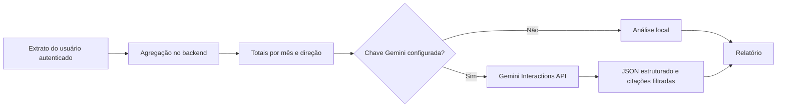

# Segurança e relatórios com IA

Atualizado em 20/09/2026.

## Problemas corrigidos

| Problema anterior | Modificação | Resultado |
| --- | --- | --- |
| JWT usava a biblioteca `jjwt` 0.9.1 e uma API antiga de assinatura | Migração para JJWT 0.12.6, chave HMAC Base64 e parser com verificação explícita | Assinatura e validação usam a API atual e rejeitam segredos fracos |
| O token permanecia no `localStorage` depois de fechar o navegador | Sessão movida para `sessionStorage`; valores legados são removidos | Reduz a persistência do token no dispositivo |
| Erros de autenticação e falhas internas podiam retornar detalhes técnicos | Respostas públicas usam códigos estáveis e mensagens genéricas; stack traces foram desabilitados | Menos informação interna exposta ao cliente |
| Login não tinha proteção contra tentativas repetidas | Limite de cinco falhas por usuário e endereço durante quinze minutos | Reduz tentativas automatizadas simples |
| CORS aceitava qualquer cabeçalho e a origem estava fixa no código | Origem configurável por `frontend_origin` e lista explícita de cabeçalhos | Política de origem mais previsível |
| O container do frontend executava o servidor de desenvolvimento | Build em duas etapas e Nginx sem privilégios, com CSP e outros cabeçalhos | Entrega adequada para o ambiente Docker |
| Não havia relatório financeiro explicado | Endpoint autenticado agrega o extrato, separa transferências internas e produz análise local ou Gemini | Fluxo de caixa mais fácil de interpretar |
| Uma IA poderia inventar fontes | Catálogo de referências controlado pelo backend; a IA só retorna IDs permitidos | A interface nunca publica uma citação fora do catálogo |
| Uma falha da API externa bloquearia o recurso | Gerador local determinístico é usado sem chave, em timeout ou em erro do provedor | Relatórios continuam disponíveis sem dependência externa |

## Fluxo dos dados



O backend nunca envia nomes, e-mails, códigos de carteira, descrições, números de referência nem IDs de banco. O provedor recebe período, totais de entrada e saída, transferências internas, quantidade de operações e série mensal. As descrições ficam fora do prompt, o que também reduz o risco de instruções maliciosas inseridas no extrato.

O relatório não tenta classificar compras porque o modelo atual não possui categorias financeiras estruturadas. Uma futura análise por categoria deve começar com uma coluna controlada, regras de acesso e migração de banco; não deve deduzir categorias a partir de texto privado por padrão.

## Configuração opcional da Gemini

No `.env.properties` local:

```properties
gemini_api_key=SUA_CHAVE_LOCAL
gemini_model=gemini-3.8-flash
```

Reinicie o backend depois de alterar o arquivo. A integração usa `POST /v1beta/interactions`, autenticação pelo cabeçalho `x-goog-api-key`, timeout e resposta JSON validada por schema. O modelo é configurável para permitir atualização sem recompilar a aplicação. `gemini_search_grounding=true` permite que a Gemini consulte a Pesquisa Google para conferir o contexto das fontes; cada consulta pode gerar cobrança do provedor.

A documentação atual do Google recomenda a Interactions API para novos projetos e oferece saída estruturada por JSON Schema. Como a API armazena interações por padrão, esta implementação envia `store=false` em todas as chamadas. Ainda assim, somente agregados sem dados pessoais saem do backend.

## Simulador de escolhas

A tela sugere, como ponto de partida editável, 10% da média mensal de saídas. O usuário decide qual valor considera evitável, o prazo e uma taxa anual hipotética. A projeção é calculada localmente no navegador pela fórmula de depósitos mensais regulares do Banco Central, com depósitos no início de cada período. Ela separa o total aportado do rendimento matemático e não envia os valores digitados à Gemini.

O resultado não considera inflação, impostos, tarifas, liquidez ou risco. A taxa não vem de um produto real e pode ser ajustada; por isso, o resultado não representa recomendação nem promessa de retorno.

## Referências usadas no produto

- [Gemini API — referência](https://ai.google.dev/api)
- [Gemini — saídas estruturadas](https://ai.google.dev/gemini-api/docs/structured-output)
- [Gemini — Grounding com Pesquisa Google](https://ai.google.dev/gemini-api/docs/google-search)
- [Gemini — Interactions API e `store=false`](https://ai.google.dev/gemini-api/docs/interactions-overview)
- [Gemini — segurança e factualidade](https://ai.google.dev/gemini-api/docs/safety-guidance)
- [Gemini — termos e retenção para detecção de abuso](https://ai.google.dev/gemini-api/terms)
- [Banco Central — Cidadania Financeira](https://www.bcb.gov.br/cidadaniafinanceira)
- [Banco Central — metodologia de aplicação com depósitos regulares](https://www3.bcb.gov.br/CALCIDADAO/publico/exibirMetodologiaAplicacaoDepositosRegulares.do?method=exibirMetodologiaAplicacaoDepositosRegulares)
- [OECD/INFE 2023 International Survey of Adult Financial Literacy](https://www.oecd.org/en/publications/oecd-infe-2023-international-survey-of-adult-financial-literacy_56003a32-en.html)
- [CFPB — Financial Well-Being Scale](https://www.consumerfinance.gov/data-research/research-reports/financial-well-being-scale/)
- [The Psychology of Money — Morgan Housel, Harriman House, 2020](https://www.harriman-house.com/authors/morgan-housel/the-psychology-of-money/9780857197689)
- [Me Poupe! — Nathalia Arcuri, Editora Sextante, edição atualizada de 2020](https://sextante.com.br/products/me-poupe-edicao-atualizada)

As obras são apresentadas como bibliografia relacionada. O relatório não reproduz trechos dos livros e não transforma a referência em aconselhamento individual.
